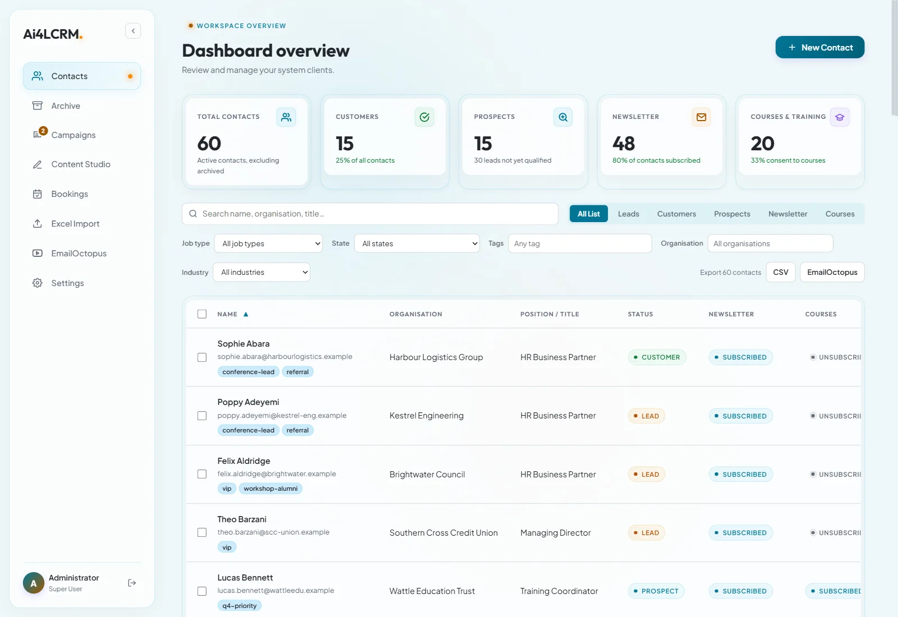
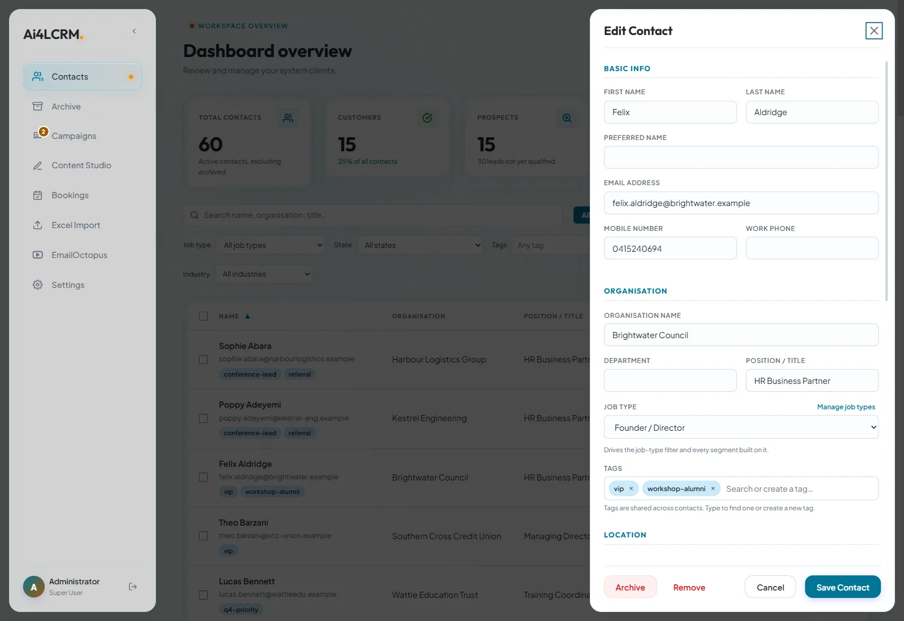
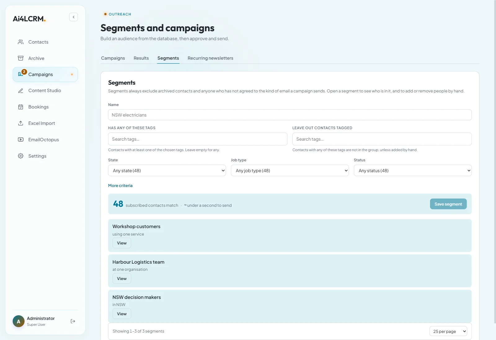
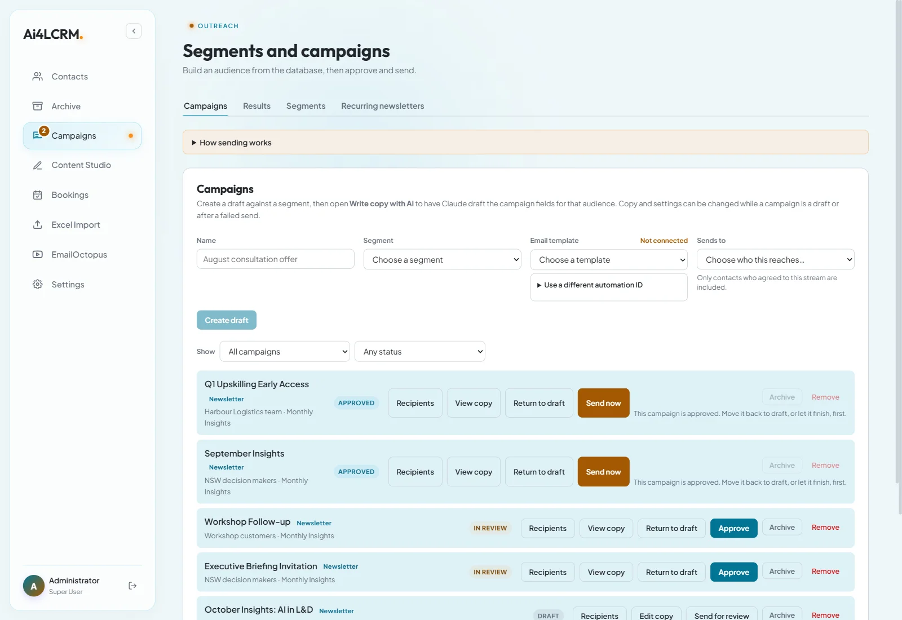
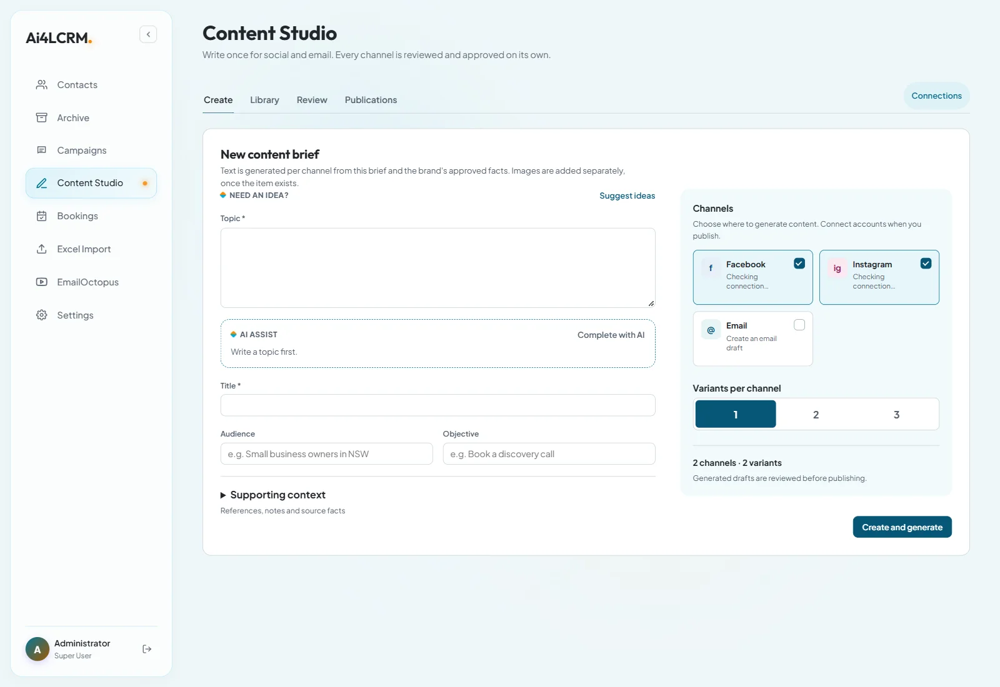

# Ai4L CRM

A private CRM and marketing-automation workspace for a small training business: one place to hold client and lead data, segment it, and send consent-safe email campaigns, with AI help for the writing and a human always approving what goes out.

**Stack:** Next.js 16 · React 19 · TypeScript · Supabase (Postgres, Auth, Row Level Security) · EmailOctopus · Stripe · Calendly · Claude API

> Screenshots use seeded demo data (fictional people and organisations), not real client records.

---

## What it does

### Contacts: the source of truth

A live overview of the whole database: customers, prospects, newsletter subscribers and course-consent counts at a glance. Search and filter by job type, state, tags, organisation and industry, switch between Leads, Customers, Prospects, Newsletter and Courses views, and export the current selection to CSV or EmailOctopus. Status and subscription state are colour-coded so the difference between a customer, a prospect and an unsubscribed contact is visible without opening anything.

Each contact opens in a side drawer with organisation, role, job type, tags and location. Contacts are never hard-deleted: "remove" is a soft delete, and archived contacts keep their history.

### Segments: reusable audiences

Build an audience from tags, state, job type, status, service or organisation and see the live count of reachable contacts before saving. Segments always exclude archived contacts and anyone who has not consented to the kind of email being sent, and individuals can be added or removed by hand.

### Campaigns: draft, review, approve, send

Campaigns move through a strict lifecycle (draft → in review → approved → sending → sent). Approval is deliberate and attributable, and the rules are enforced by the database itself (triggers and constraints), not just the UI, so an unapproved campaign cannot be sent even by a buggy client. Claude can draft the campaign copy for a segment, but nothing it writes can send on its own.

Other pieces behind this screen: recurring newsletters on a schedule, per-campaign results, and separate consent streams for newsletters and for course/program offers.

### Content Studio: write once, publish per channel

Turn a single brief (topic, audience, objective) into channel-specific drafts for Facebook, Instagram and email, grounded in the brand's approved facts and tone. Every variant is reviewed and approved on its own before publishing.

### Also in the app
- **Excel / CSV import** with column mapping, organisation matching and a validation summary before anything is committed.
- **Bookings**: paid-then-scheduled consultations via Stripe Checkout and Calendly, with webhook reconciliation.
- **EmailOctopus sync** for subscription status in both directions, plus one-click unsubscribe and a preferences page for contacts.
- **Archive** for removed contacts and campaigns, and a role-based, invite-only workspace (admin and operator roles).

---

## Engineering highlights
- **Safety enforced in Postgres**: row-level security on every table, an approved-members-only policy, status-transition triggers, consent-version tracking and replay-safe webhook handling, all verified by database test suites.
- **Consent-first by design**: sending always checks the contact's consent for that stream; unsubscribes are honoured immediately and propagated to the email provider.
- **Tested end to end**: unit and integration tests (Jest), browser E2E and accessibility checks (Playwright across Chromium, Firefox and WebKit), targeting WCAG 2.1 AA.
- **Real-world integrations** handled defensively: idempotent webhooks, an outbox for provider sync, and clear "not configured" states when a key is missing.
