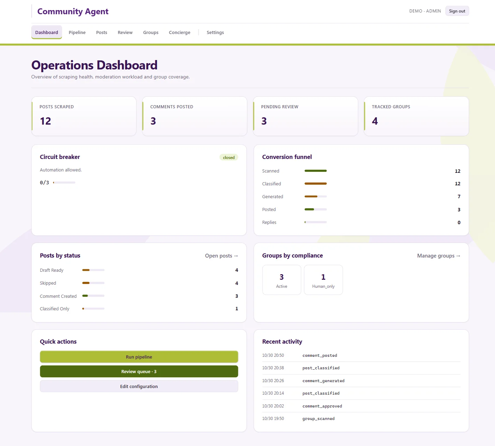
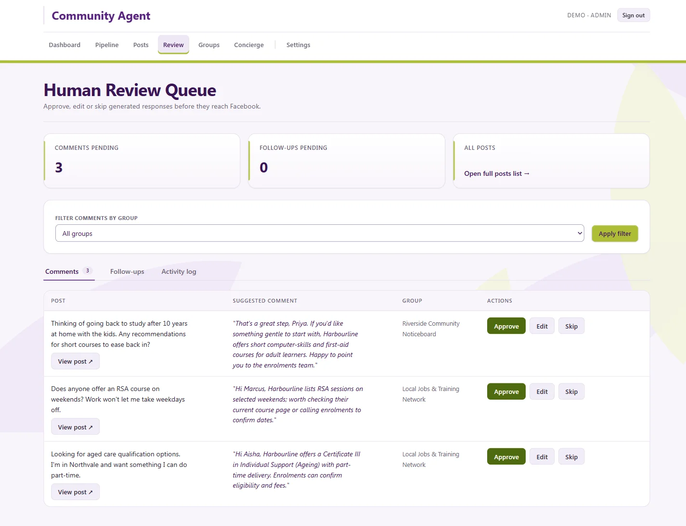
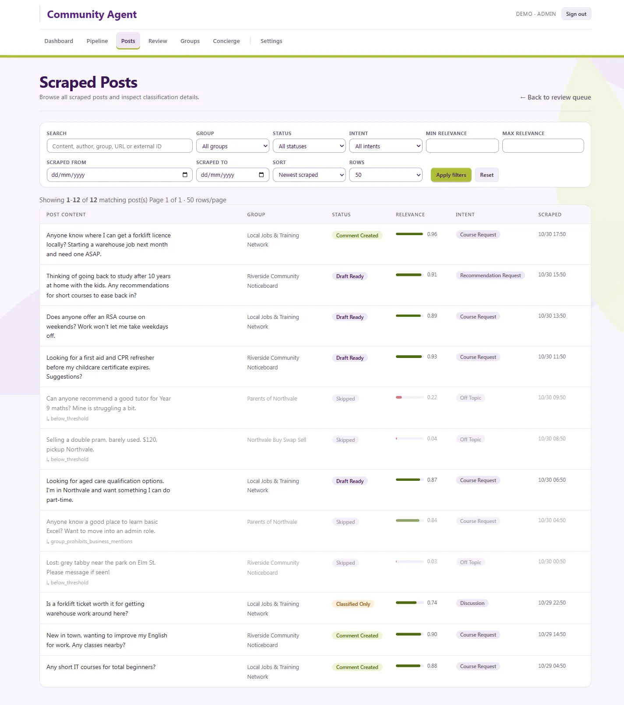
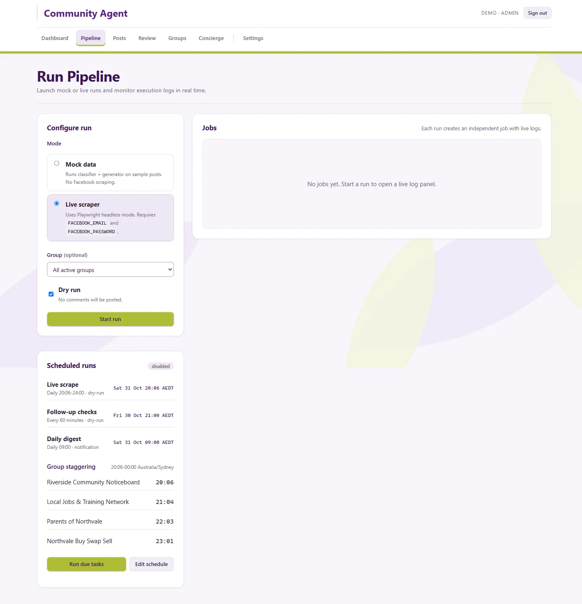

# Social Media Scout

An agentic system that monitors community groups on Facebook, uses AI to decide which posts are genuinely worth answering, drafts a helpful reply, and puts a human in the loop before anything goes public.

It is business-agnostic: everything it knows about the organisation (what it offers, tone of voice, limits, schedule) and about each group (rules, compliance status) lives in validated YAML configuration, so the same engine can serve a training provider, a local shop or a non-profit.

> Screenshots use fictional demo data ("Harbourline Training Co.") created for this page. No real groups, people or posts are shown.

## What it does

1. **Scrapes** the groups it is configured to watch (Playwright, headless Chromium) on a staggered schedule.
2. **Classifies** each post with Claude: relevance score, intent (course request, recommendation request, discussion, off-topic) and a written reason.
3. **Checks the rules** before writing a word. A policy engine reads each group's rules (interpreted by AI, overridable by a human) and enforces rate limits, "no promotion" groups, admin-approval groups and kill switches.
4. **Drafts a reply** only when the post explicitly asks for something the business really offers. Tone, goals and prohibitions come from config; the reply is transparent, never pretends to be an unaffiliated local.
5. **Human review.** Drafts land in a queue where a person approves, edits or skips them.
6. **Follows up.** After posting it checks whether the comment survived moderation, tracks replies and can draft follow-ups.

## Screenshots

### Operations dashboard

Health at a glance: posts scraped, comments posted, items waiting for review, conversion funnel (scanned → classified → generated → posted → replies), circuit-breaker state, groups by compliance status and a live audit trail of every action.

### Human review queue

The core safety feature. Each row pairs the original post with the AI-suggested comment and the group it came from; a person decides to **Approve**, **Edit** or **Skip**. Nothing reaches Facebook without passing here (unless a group is explicitly configured otherwise).

### Scraped posts and AI classification

Every post the scraper has seen, filterable by group, status, intent, relevance range and date. Relevance is shown as a bar with its score, skipped posts are dimmed with the exact skip reason (`below_threshold`, `group_prohibits_business_mentions`), so decisions are explainable instead of a black box.

### Pipeline control

Launch mock or live runs with a dry-run toggle, watch logs per job, and see the scheduled tasks (scrape window, follow-up checks, daily digest). Groups are staggered across the window so activity doesn't look robotic.

## Safety by design

- **Dry-run is the default.** Real posting needs an explicit `POSTING_ENABLED=true` and a live flag; the live command refuses to start otherwise.
- **Defence in depth on limits.** Rate limits are enforced at the config, policy and poster layers independently.
- **Kill switches** at global, per-group and per-action level, plus a **circuit breaker** that pauses automation after repeated failures.
- **Compliance tracking.** Comment survival rate per group; groups that remove too many comments are paused or moved to human-only.
- **Full audit trail** of every action, and a mandatory 7-day dry-run period before going live.
- **Hardened admin UI:** login with rate-limited attempts, CSRF protection, signed sessions, CSP with nonces, read-only role.

## Under the hood

| Area | Choice |
|------|--------|
| Language | Python |
| AI | Anthropic Claude API (classification, rule interpretation, comment generation) |
| Browser automation | Playwright (Chromium) |
| Web UI | FastAPI + Jinja2 + HTMX |
| Data | SQLAlchemy + Alembic, SQLite (dev) / PostgreSQL (prod) |
| Config | Pydantic-validated YAML (business, groups, prompts) with a built-in editor, version history and playground |
| Scheduling | Async daemon with persistent checkpoints so interrupted runs can resume |
| Deployment | Docker, Fly.io |

**Architecture:** hexagonal (ports and adapters) with dependency injection. The core domain (classifier → policy engine → comment generator → pipeline orchestrator) has zero dependency on Facebook; the scraper/poster, database and notifications are adapters that can be swapped or mocked.

**Quality:** built with strict TDD (red → green → refactor), a test pyramid (unit / integration / E2E), HTML-snapshot tests for the scraper so no live Facebook is needed, contract tests between modules, and AI outputs asserted on structure and constraints rather than exact text. Every bug becomes a regression test.

## Other features

- **Website concierge:** an embeddable chat widget that answers course questions for visitors arriving from Facebook campaigns, grounded in a configurable catalogue.
- **Config editor:** edit business and group settings in the UI with schema validation, history and one-click restore.
- **Notifications:** email / Slack digests and alerts.
