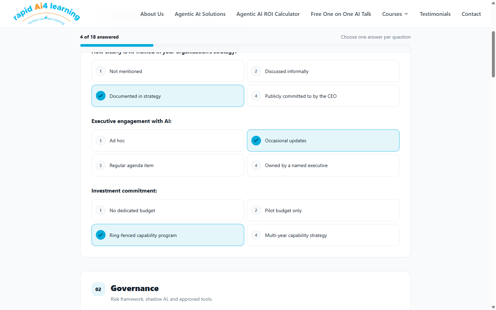
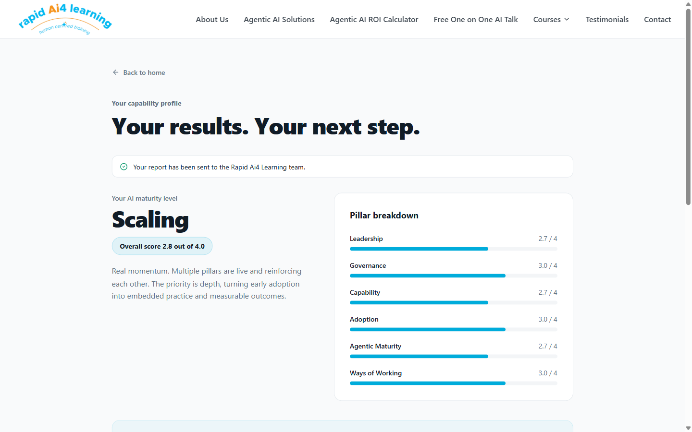
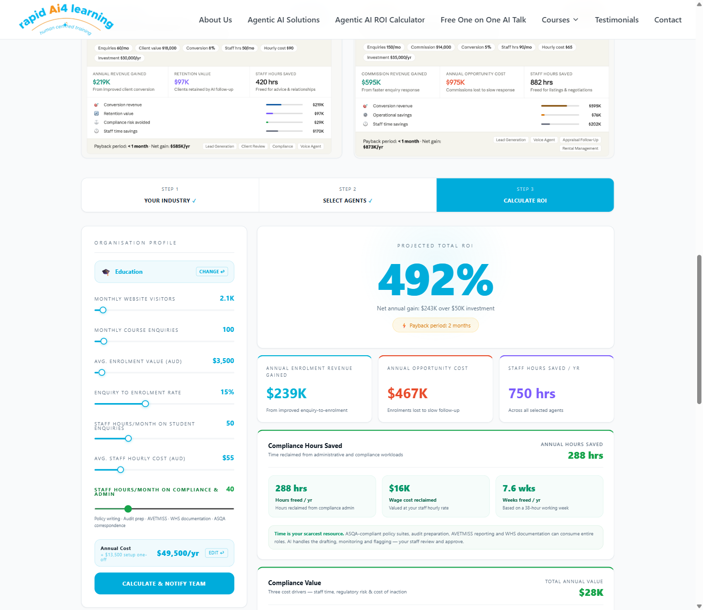
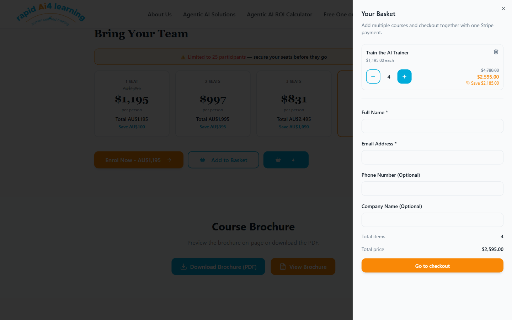
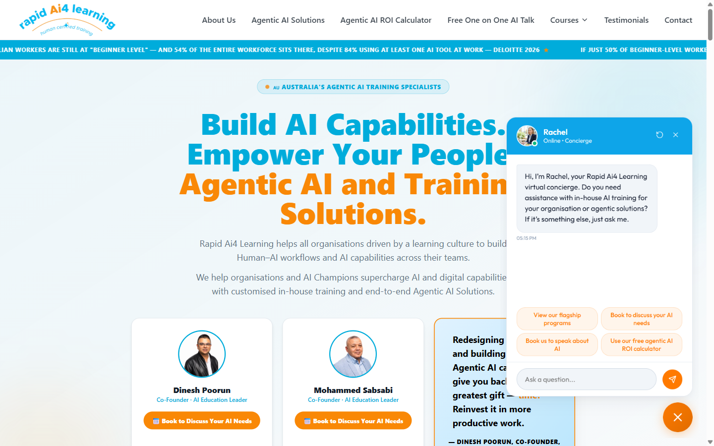

# Ai4L (Rapid Ai4 Learning) — Features I Built

Contributions I made while collaborating with the Rapid Ai4 Learning team on their
marketing and enrolment site (React, TypeScript, Vite, Tailwind, shadcn/ui, Supabase, Stripe).

---

## 1. AI Capability Strategy Assessment

| Questions | Results |
|---|---|
|  |  |

A free, six-minute self-assessment that lead-gens for the business. Visitors enter a first name and
answer 18 multiple-choice questions grouped into six pillars: Leadership, Governance, Capability,
Adoption, Agentic Maturity and Ways of Working.

- Live progress bar and answered-count, with the submit button locked until every question is answered.
- A scoring engine computes a score per pillar and an overall maturity level (for example "Scaling").
- The results page shows a pillar breakdown, the two weakest pillars as "Where to focus first", and a
  call to action to book a 30-minute consultation.
- The report is emailed to the Ai4L team through a Supabase edge function, with validation and an
  error/retry state if sending fails.
- Accessibility work: focus management between screens, keyboard-friendly radio groups, per-page SEO meta,
  lazy-loaded route, and the chat widget hidden on this page so it never covers the controls.

## 2. Agentic AI ROI and Opportunity Cost Calculator

A three-step consultation tool (Industry, Agents, Calculate) that turns vague "AI could help" claims
into a dollar figure.

- Industry selector (Education, Real Estate, Financial Services and more) preloads realistic benchmarks.
- Agent picker with per-agent pricing and "suggested" agents for the chosen sector.
- Real-time results as sliders move: projected ROI %, net annual gain, payback period, opportunity cost
  and staff hours saved.
- Compliance model for RTO/TAFE organisations: hours of compliance admin reclaimed, wage cost and weeks freed.
- Results are sent to the team via "Calculate & notify team", so sales gets a qualified lead with the numbers.

## 3. Course Basket with Volume Pricing and Stripe Checkout

A multi-course basket so visitors can enrol several people, or several courses, in a single payment.

- Global basket context and slide-in sheet, with quantity controls and a seat cap per course.
- Tiered volume pricing engine. On "Train the AI Trainer" four seats cost AU$2,595 instead of AU$4,780,
  with the saving and the struck-through price shown live.
- Checkout form creates one Stripe payment through a Supabase function, then enrols and invites the user
  in Coursebox after payment.
- Inputs such as the Coursebox ID are validated and sanitised before use.

## 4. AI Concierge Chat Widget

Integration of the "Rachel" virtual concierge across the whole site, replacing the earlier chatbot.

- Loader script injected once and cleaned up on unmount, so it does not leak between routes.
- Quick-reply buttons route visitors to flagship programmes, booking, speaking requests and the ROI calculator.
- Context-aware: hidden on the assessment page to keep the form unobstructed.

---

## Also shipped (no screenshot)

- Calendly booking links wired into talks, agentic AI and contact forms through environment variables.
- Newsletter float component and layout/z-index fixes.
- Accessibility IDs and anchors on key landing sections.
- Open Graph / Twitter metadata, favicon and brand-spelling fixes.
