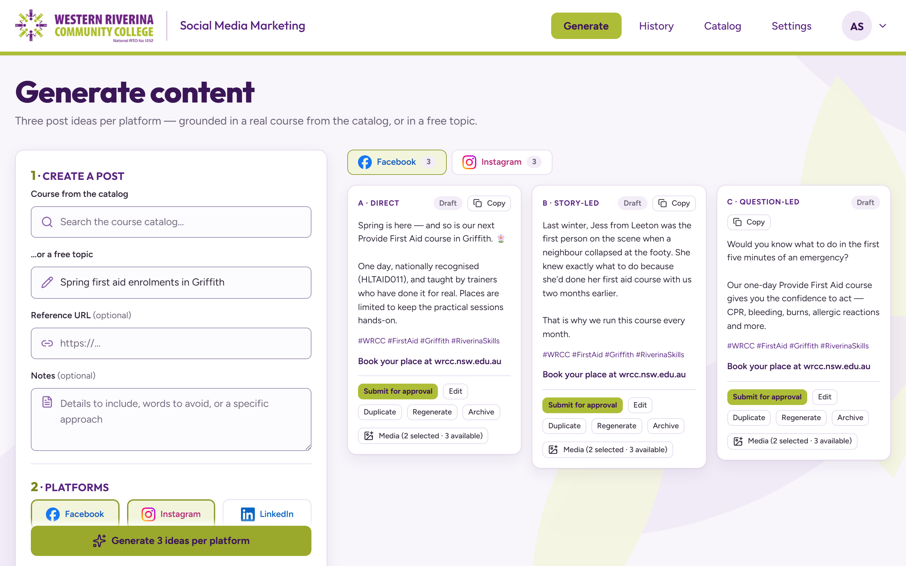
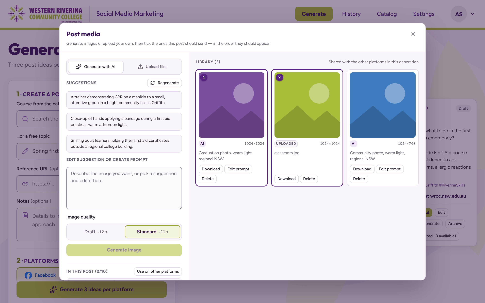
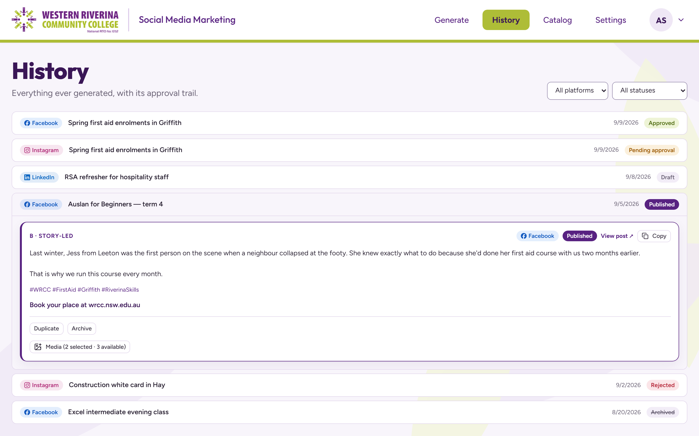
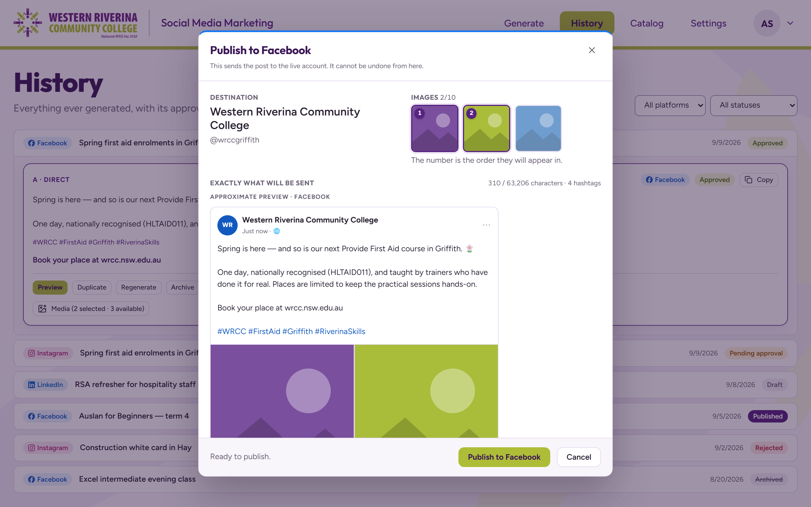
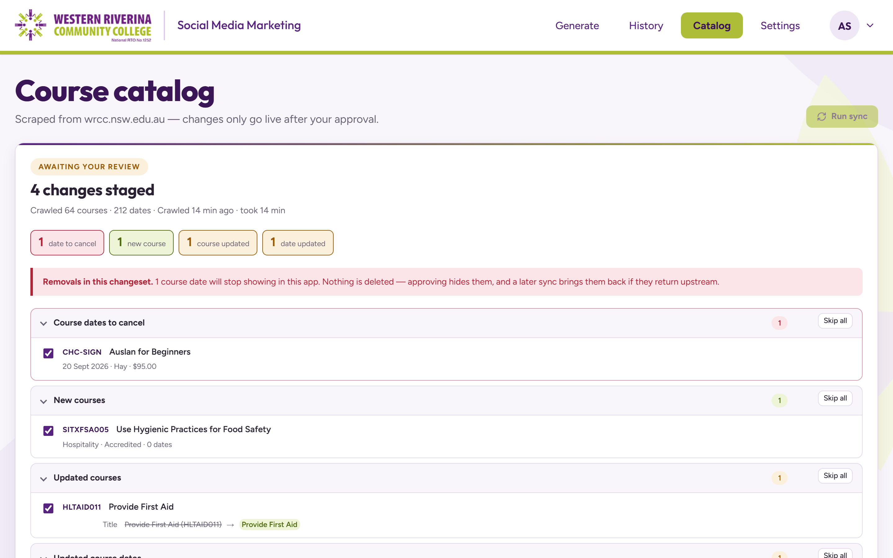

# WRCC Social Media Marketing

An internal content studio for [Western Riverina Community College](https://wrcc.nsw.edu.au/) (NSW, Australia).
It turns the college's real course catalog into ready-to-publish posts for Facebook, Instagram and LinkedIn,
with a human approval step before anything goes live.

Stack: Next.js 14, React 18, TypeScript, CSS modules, FastAPI, SQLAlchemy 2 (async), PostgreSQL, Alembic,
Gemini / OpenAI behind a provider-agnostic LLM client, httpx + BeautifulSoup scraper.
Backed by 500 backend tests (pytest) and 160 frontend tests (vitest) plus Playwright.

> Screenshots use sample data.

---

## 1. Generate post ideas

Pick a course from the scraped catalog, or write a free topic with an optional reference URL and notes, then
choose the platforms. The app returns three post ideas per platform, each with a different angle
(direct, story-led, question-led) and tone and format adapted to the network.

- Posts are grounded in real course data: name, code, price, upcoming dates and locations.
- Writing speed vs. quality can be traded off per request.
- Every variant can be copied, edited, duplicated, regenerated or archived.

## 2. Post media library

Images can be generated by the LLM from editable prompt suggestions, or uploaded by hand, as two clearly separate actions.

- Assets belong to the whole generation, so a photo uploaded for the Facebook post is also available to the
  Instagram and LinkedIn ones.
- Each post chooses which images it sends and in what order (numbered badges).
- Draft / Standard image quality, download, edit prompt and delete on every asset.

## 3. History and approval workflow

Everything ever generated is kept with its status trail: `draft → pending approval → approved / rejected → published`,
plus archive and restore. Filter by platform and status, expand any row to see the full post and a link to the live one.
Every transition is written to an audit log.

## 4. Publish with a real preview

Approved posts are sent to the Facebook Page, Instagram Business account or LinkedIn Company Page they were written for,
from inside the app.

- The dialog shows the destination, the selected images and their order, character and hashtag counts,
  and the post rendered in that network's own chrome before it is sent.
- Supports a single image or several (multi-photo, carousel, multi-image).
- Accounts are connected once through OAuth and tokens are encrypted at rest.

## 5. Catalog sync with human review

A polite scraper (request delay, bounded retries) crawls the WRCC website and stages a diff instead of
writing to the live catalog.

- The review screen groups changes: new courses, updated courses, updated dates and dates to cancel,
  with before → after values for price and places left.
- Removals are called out explicitly. Nothing is deleted: approving hides them, and a later sync restores them
  if they come back upstream.
- Individual changes can be unticked, or a whole group skipped, before "Approve & apply".

---

## Also built

- Login with argon2 password hashing and a JWT in an httpOnly cookie.
- Connections page for linking and checking social accounts, with token-expiry warnings.
- WRCC-branded UI with accessibility and visual-regression guards in the test suite.
